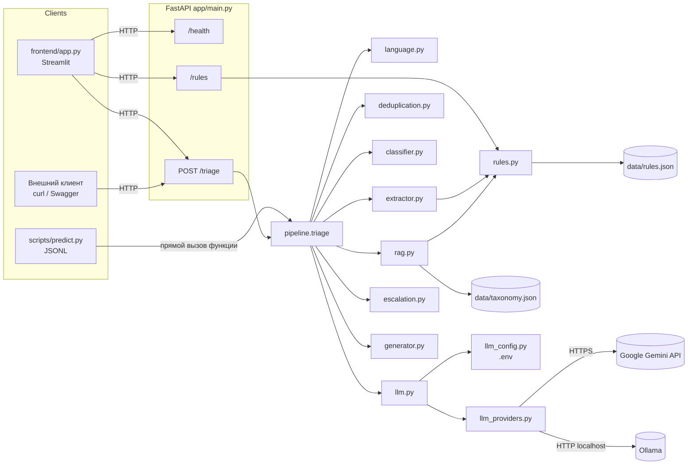
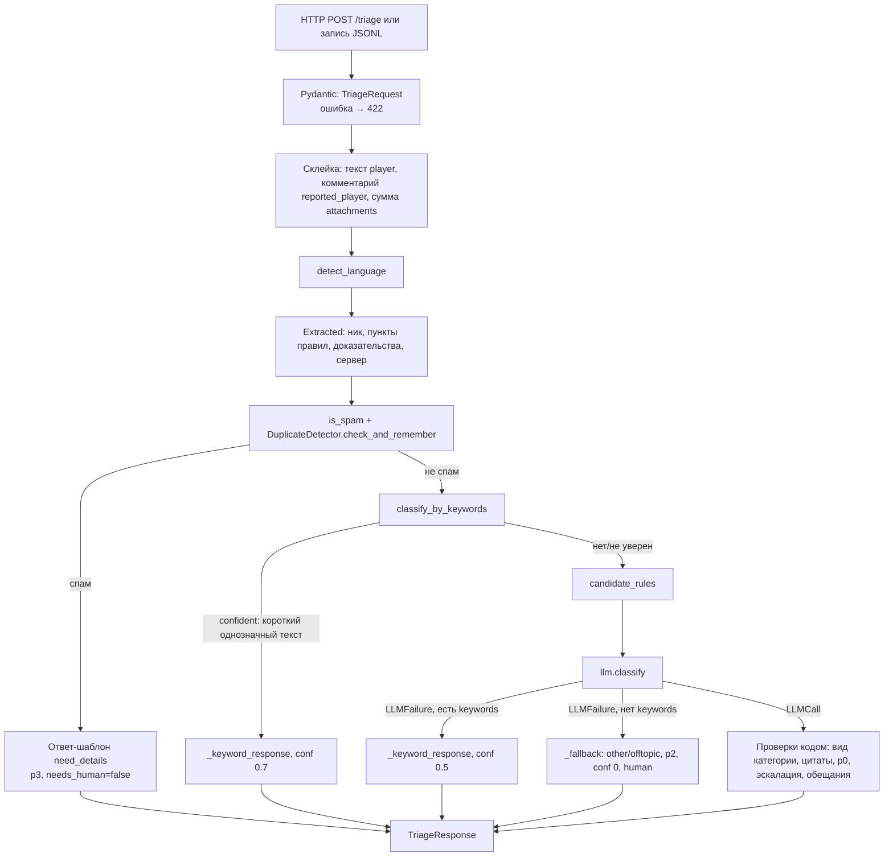

# PROJECT_CONTEXT — Support Copilot by Grand Mobile

> Документ для AI-ассистента, который не видит исходный код. Описывает **то, что реально реализовано**
> на 2026-10-31, с именами файлов и функций. Где что-то не проверено или не реализовано — сказано явно.
> Пользовательская документация — `README.md`, контракт API — `API.md`.

---

## 1. Что это и какую задачу решает

Хакатон Decentrathon 6.0, кейс Grand Mobile (мобильная RP-игра, серверы СНГ/Узбекистан/Казахстан).
Администраторы поддержки разбирают поток обращений игроков двух видов:

- `complaint` — жалоба на игрока из лаунчера (часто короткая: «оск родни», «дм», «2.1 оп» + скриншоты);
- `report` — внутриигровой репорт («помогите», «застрял», «+»).

**Support Copilot** — backend-сервис (+ интерфейс), который по одному обращению возвращает JSON:
язык, категорию, приоритет p0–p3, извлечённые факты, признак спама/повтора, **черновик ответа на языке игрока
с цитатами реальных пунктов правил**, решение «нужен ли администратор» (`needs_human`), уверенность и причины.

### Требования ТЗ (как их сформулировала команда) и статус

| Требование | Статус |
|---|---|
| Языки ru, kk, uz, en, es, pt | Реализовано эвристиками (раздел 6.1); es/pt в valid почти нет — не проверены на данных |
| Категория (14 из `taxonomy.json`), приоритет p0–p3 | Реализовано: ключевые слова + LLM |
| Извлечение фактов (ник, пункты правил, доказательства, сервер) | Реализовано регулярными выражениями |
| Спам и дубликаты | Спам — реализовано; дубликаты — только дословные повторы |
| RAG по правилам, цитаты только существующих пунктов | Реализовано (упрощённый RAG без векторной базы, см. раздел 7) |
| Черновик на языке игрока | LLM или шаблоны на 6 языках |
| Не выдумывать правила, не считать обвинения доказанными, не обещать разбан/возврат/наказание | Цитаты и обещания проверяет код; «не считать доказанным» — только промпт + фильтр фраз о скриншотах |
| Платежи, апелляции, взлом — всегда человеку | Реализовано кодом (регулярные выражения + категории) |
| Стоимость ≤ $0.002 на обращение, p95 ≤ 5 с | Без LLM: $0, < 0.01 с. С Gemini free tier: $0, p95 ≈ 4.0 с |
| `make predict` по JSONL | `scripts/predict.py` + `Makefile` |
| Не падать при некорректном ответе LLM | Реализовано: любая ошибка LLM → запасной ответ |

---

## 2. Технологии и запуск

Python 3.11+ (используется 3.13), FastAPI + Pydantic v2, uvicorn, `google-genai` (Gemini), `httpx` (Ollama и frontend),
Streamlit + pandas (frontend), pytest. Нет базы данных, нет векторной БД, нет Docker.

```powershell
py -3 -m venv .venv ; .\.venv\Scripts\Activate.ps1
pip install -r requirements.txt
copy .env.example .env                 # по умолчанию LLM_PROVIDER=disabled
# файлы кейса кладутся в data/ (не в git): tickets_train.jsonl.gz, tickets_valid.jsonl, rules.json, taxonomy.json
uvicorn app.main:app --reload          # backend, http://127.0.0.1:8000/docs
streamlit run frontend/app.py          # интерфейс, http://localhost:8501
python -m pytest -q                    # 235 тестов, без сети
python -m scripts.predict --provider disabled --output outputs/x.jsonl
python -m scripts.evaluate --pred outputs/x.jsonl
```

Linux/macOS: `make install | run | frontend | test | predict | predict-offline | measure`.

---

## 3. Структура и назначение файлов

| Файл | Назначение | Ключевые объекты |
|---|---|---|
| `app/main.py` | FastAPI: endpoints; при старте проверяет наличие `data/rules.json` и `data/taxonomy.json` (`missing_data_files`) и вызывает `llm.init()` (lifespan); `.env` читается только из корня проекта (`llm_config.ENV_PATH`) | `health`, `triage`, `rules` |
| `app/schemas.py` | Контракт API (Pydantic) | `Message`, `TriageRequest`, `TriageResponse`, `Extracted`, `DraftReply`, литералы `Category`, `Priority`, `Lang` |
| `app/pipeline.py` | **Оркестратор** обработки одного обращения | `triage()`, `_keyword_response()`, `_fallback()`, глобальный `duplicates` |
| `app/services/rules.py` | Реестр пунктов правил с уникальными ID | `load_rules()`, `rule_exists()`, `get_rule()`, `filter_existing()`, `PREFIX_BY_DOC`, `ALIASES`, `UNKNOWN_CODES` |
| `app/services/extractor.py` | Факты из текста | `extract_rule_refs()`, `extract_nickname()`, `extract_server()`, `has_evidence()` |
| `app/services/language.py` | Язык | `detect_language()` → `(lang, confident)` |
| `app/services/deduplication.py` | Спам и повторы | `is_spam()`, `DuplicateDetector.check_and_remember()`, `.forget_last()` |
| `app/services/classifier.py` | Категория/приоритет по ключевым словам | `classify_by_keywords()` → `KeywordResult(category, priority, confident)` |
| `app/services/rag.py` | Кандидаты правил для LLM | `candidate_rules()`, `load_taxonomy()`, `categories_for()` |
| `app/services/llm.py` | Промпт, схема, кэш, повторы, лимит частоты, учёт токенов | `init()`, `classify()` → `LLMCall` или `LLMFailure`, `LLMResult` |
| `app/services/llm_config.py` | Настройки из `.env`, allowlist моделей Gemini, маскирование ключа | `load_settings()`, `LLMSettings`, `GEMINI_ALLOWED_MODELS`, `LLMConfigError`, `redact()` |
| `app/services/llm_providers.py` | Провайдеры | `GeminiProvider`, `OllamaProvider`, `ProviderError(kind, code, message)`, `ProviderReply` |
| `app/services/escalation.py` | Эскалация, запрещённые обещания, адресат черновика | `sensitive_reasons()`, `decide_needs_human()`, `check_priority()`, `forbidden_in_reply()` |
| `app/services/generator.py` | Шаблонные ответы на 6 языках | `template_reply(name, lang)`, `template_for(category, player_text, has_evidence)` (апелляция по тексту игрока; без доказательств — `complaint_no_evidence`); шаблоны `complaint_received`, `complaint_no_evidence`, `appeal_received`, `received`, `need_details`, `duplicate` |
| `app/services/normalize.py` | Нормализация Unicode на входе | `normalize_text()` |
| `frontend/app.py` | Streamlit, только HTTP к backend | `show_result()`, `parse_predictions()`, вкладки «Обращение» и «Результаты predict» |
| `scripts/dataset.py` | JSONL датасета → `TriageRequest` | `read_jsonl()`, `request_from_record()` |
| `scripts/predict.py` | Пакетная обработка | лимит частоты, ожидание при 429, продолжение с места остановки |
| `scripts/evaluate.py` | Метрики | инварианты безопасности, косвенные метки, эталон |
| `scripts/measure_llm.py` | Замер задержки/токенов LLM на выборке | |
| `scripts/eval_rag.py` | Recall@k / Precision@k / MRR retrieval по пункту наказания админа | |
| `scripts/eval_drafts.py`, `scripts/synthetic_tickets.py` | 16 синтетических обращений: черновики, холодный/прогретый старт, слепой лист | |
| `tests/` | 235 тестов pytest | см. раздел 12 |
| `data/` (не в git) | Данные кейса + эталон `eval_gold.jsonl` (80 тикетов) | |
| `outputs/` (не в git) | Результаты `predict` | |

---

## 4. Архитектура



Важно: `scripts/predict.py` **не ходит по HTTP**, а вызывает `pipeline.triage()` напрямую — поведение то же, что у API.
Frontend не содержит бизнес-логики и не импортирует backend.

**Внешние зависимости:** только `GeminiProvider` (Google, по интернету). `OllamaProvider` — HTTP к локальному процессу.
**Полностью локально:** всё остальное — язык, извлечение, спам, дубли, ключевые слова, RAG, эскалация, шаблоны, метрики.

---

## 5. Путь одного обращения (`pipeline.triage`)



Пошагово (всё в `app/pipeline.py::triage`, если не сказано иное):

| # | Этап | Где | Вход → выход | Ошибки и поведение при отказе |
|---|---|---|---|---|
| 1 | Приём | `main.triage` / `predict.py` → `pipeline.triage` | JSON → `TriageRequest` | Невалидный JSON/поля → **422** (FastAPI). В predict запись датасета превращается `scripts/dataset.request_from_record` (ответ админа отбрасывается; `images_count` приписывается первому сообщению игрока) |
| 2 | Валидация | `schemas.TriageRequest` | `kind ∈ {complaint, report}`, 1–50 сообщений, `text` ≤ 5000, `attachments` 0–100, `reporter_id` ≤ 128, `reported_nick` ≤ 64, `server_lang` ≤ 8 | 422 |
| 3 | Подготовка | `triage`, `normalize.normalize_text` | `player_text` = тексты role=player через `\n` после нормализации Unicode; `accused_comment` = role=reported_player; `attachments` = сумма по player | — |
| 4 | Язык | `language.detect_language(text, server_lang)` | → `(lang, confident)`, `lang` всегда из 6 | Не понятно → `server_lang` или `ru`, в `reasons` пишется «Язык не определён…» |
| 5 | Факты | `extractor.*` | ник: `request.reported_nick` или первый `Имя_Фамилия\d*` из текста; `rule_refs` — только существующие ID; `has_evidence` = вложения>0 или ссылка; `server` — число рядом со словом «сервер» | Ничего не найдено → `null`/`[]` |
| 6 | Спам | `deduplication.is_spam` | Нет вложений/ссылок и (нет букв и нет пунктов правил, или одна повторяющаяся буква ≥3 раз) | Спам → **немедленный ответ**: `complaint.invalid`/`report.offtopic`, p3, `need_details`, `needs_human=false`, conf 0.9 |
| 7 | Повтор | `DuplicateDetector.check_and_remember(reporter_id, nickname, text, created_at)` | Дословный (после нормализации) повтор того же `reporter_id` про того же ника за 24 ч | Без `reporter_id` или ника — не проверяется. Повтор не останавливает обработку: категория считается, черновик заменяется шаблоном `duplicate`, цитаты обнуляются |
| 8 | Ключевые слова | `classifier.classify_by_keywords(kind, text, rule_refs)` | → `KeywordResult` или `None`; `confident=True`, если «ядро» текста ≤ 25 символов | Уверенно → `_keyword_response` (**LLM не вызывается**) |
| 9 | RAG | `rag.candidate_rules(kind, rule_refs)` | Пункты игрока + пункты категорий этого `kind` из таксономии | — |
| 10 | LLM | `llm.classify(...)` | → `LLMCall(result: LLMResult, cost_usd, latency_s, tokens, cached)` или `LLMFailure(kind)` | Любая ошибка → `LLMFailure`; pipeline: если были ключевые слова → `_keyword_response` (conf 0.5), иначе `_fallback` |
| 11 | Проверка ответа | `triage` после LLM | Категория должна начинаться с `kind.` (иначе `_fallback`); `cited` ∩ кандидаты RAG; `check_priority`; затем приоритет = `classifier.category_priority(category)` (LLM может только оставить p0 при признаках взлома/платежа/угроз) | — |
| 12 | needs_human | `escalation.decide_needs_human` | OR от: чувствительные слова, `needs_human_always`, p0, категория из `_ADMIN_ACTION_CATEGORIES`, conf < 0.5, мнение LLM | LLM может только **добавить** эскалацию |
| 13 | Черновик | `escalation.forbidden_in_reply`, `misaddressed_reply`, `pipeline._draft_language_problem`, `generator.template_for` | Ответ LLM; запрещённая фраза или неверный адресат → адресный шаблон категории, цитаты обнуляются, `needs_human=true`; расхождение LLM с ключевыми словами → шаблон; язык не в `LLM_DRAFT_LANGS` или ответ не на языке игрока → шаблон (проверенные цитаты сохраняются); шаблон `complaint.admin` учитывает ключевые слова (пострадавшему — «спасибо за жалобу») | — |
| 14 | Ответ | `TriageResponse` | Pydantic проверяет диапазоны (`confidence` 0–1, литералы) | — |

---

## 6. Детерминированная логика без LLM

### 6.1 Язык (`language.detect_language`)
Перед анализом `pipeline` нормализует текст (`normalize.normalize_text`: NFKC + удаление невидимых символов Cf —
«Ｏｓｋ», «𝐨𝐬𝐤», zero-width внутри слов). Из текста удаляются токены `<url>`, ники и числа. Кириллица ≥ латиницы →
`uz`, если есть «ў/ҳ»; `kk`, если есть «әңөұүһқғ»; затем короткие словари частых слов `_CYR_WORDS` (kk: «себепсіз, менің…», без «мені» — оно есть в украинском; uz: «мени, сабабсиз, учун…»); иначе `ru` (украинский тоже → `ru`). Латиница → `uz` по апострофу
«oʻ/g'», `kk` по казахской латинице «ä ğ ı ş ū» (до испанского), `es` по «ñ¿¡», `pt` по «ãõç»,
иначе подсчёт словарных слов (`_WORDS` для uz/en/es/pt и **русского транслита** «osk rodni»). Нет совпадений → `server_lang`/`ru`. Латиница, похожая на uz, без апострофа на сервере `kk` → `kk`.

### 6.2 Правила и ссылки (`rules.py`, `extractor.extract_rule_refs`)
`rules.json` содержит 11 документов (`id`, `category` = название, `points: [{ref, text}]`), всего 266 пунктов;
номера повторяются между документами («1.1» есть в 10 документах). Поэтому ID = префикс документа + номер:
`""` (общие правила, 30), `ЖБ` (жалобы, 31), `GZ` (зелёная зона, 32), `ОПЛЗ` (33), `ПГО` (34), `ПГВД` (35),
`FW` (семейные мероприятия, 36), `ОПГ` (40), `ВБ` (41), `БЗФ` (42); документ 43 без пунктов не загружается.
`ALIASES` — написания игроков/админов (ОП/OP/ОР/общих → общие; ГЗ/ЗЗ/GREEN → GZ; ППЖ → ЖБ; ФВ → FW…).
`UNKNOWN_CODES` (УК, ФП, ПН, ППО, ППИО, GW) — ссылки на документы, которых нет в `rules.json`, **отбрасываются**.
Слово после номера, не являющееся кодом («2.1 и мат»), считается общими правилами. Результат всегда
фильтруется `filter_existing` — несуществующие ID не попадают в `rule_refs`.

### 6.3 Классификатор (`classifier.classify_by_keywords`)
- **report** (порядок важен): `report.account` p0 (взлом, пропало имущество) → `report.help` p2 (застрял, переверните,
  наручники, спавн, почините) → `report.complaint` p2 (дм, чит, оск, «за что», наказание, мут; p1 при читах) →
  `report.offtopic` p3 для «телепорт/тп» (решение команды) → `report.offtopic` p3 для «помогите/хелп/sos/ау/привет/+» целиком →
  `report.question` p3 («?» или «как/где/когда…»).
- **complaint**: апелляция (`SENSITIVE_PATTERNS["appeal"]`) → `complaint.admin` p2 → пункт правил игрока
  (2.1/2.4/2.6 → insult, 5.2 → cheat, 5.3/5.4/GZ → dm, 4.1/4.2 → scam, 2.3/4.4 → rmt_ads) → слова:
  cheat → scam → rmt_ads → insult → dm.
- Приоритеты статические (`_PRIORITY`, `category_priority()`): insult/dm/admin/other p2, cheat/scam/rmt_ads p1, invalid p3; report.account/payment p0, help/complaint p2 (complaint с читами p1), question/offtopic p3. Те же правила применяются к ответу LLM (замер 2026-10-31: qwen2.5:3b ставила p1 оскорблениям и DM).
- `confident=True`, если после удаления ссылок, чисел-пунктов и пунктуации текст ≤ 25 символов.
- Ни одно правило не дало `complaint.invalid` или `complaint.other` — такие категории в режиме без LLM возникают
  только из спама (`invalid`) или `_fallback` (`other`).

### 6.4 Эскалация (`escalation.py`)
- `SENSITIVE_PATTERNS`: `appeal`, `hacking`, `payment`, `threat` — регулярные выражения по тексту игрока (ru/uz/en/es/pt-маркеры).
- `decide_needs_human` — см. этап 12. `_ADMIN_ACTION_CATEGORIES` — все жалобы, кроме `complaint.invalid`, плюс
  `report.help`, `report.complaint`, `report.account`, `report.payment`. `needs_human_always` из таксономии:
  `report.account`, `report.payment`, `complaint.admin`.
- `check_priority`: p0 остаётся только для `report.account`/`report.payment` или при признаках взлома/платежа/угроз; иначе снимается, и приоритет берётся из `category_priority`.
- `FORBIDDEN_IN_REPLY`: обещание разбана/снятия наказания, возврата денег/имущества, наказания другого игрока,
  утверждение о содержимом скриншотов, утверждение «жалоба/нарушение подтверждено» (ru/en/uz/kk/es/pt-маркеры);
  плюс отдельная проверка контактов: e-mail/URL/телефон в черновике допустимы, только если встречаются в `rules.json`.
- `FORBIDDEN_IN_REPLY` дополнен (слепая оценка 2026-10-31): обещание восстановления аккаунта/имущества, «нарушение
  явно/clearly» как факт, утверждение о статусе платежа. Для утверждений о нарушении **условная** форма («если нарушение
  подтвердится», «if a violation is confirmed») пропускается (`_CONDITIONAL`).
- `misaddressed_reply(category, reply)`: для жалоб на другого игрока и апелляций ловит указания заявителю
  («воздержитесь», «не используйте», refrain…) и объявление его виновным («вы нарушили», «наказание выдано верно»).
- `disagreement_reason(llm_category, keyword_category)`: если ключевые слова дали категорию из
  `_ADMIN_ACTION_CATEGORIES`, а LLM — категорию без участия админа, `needs_human=true`, а черновик LLM заменяется
  шаблоном (вызывается в `pipeline.triage`).
- Апелляции: `SENSITIVE_PATTERNS["appeal"]` дополнен маркерами, подобранными на train (ru «дал варн без причины»,
  «не правильно выдал», «предоставьте доказательства»; uz прошедшее время «ban berishdi», «soft emasman»).

На всём valid без LLM `needs_human=true` у **93.8%** обращений — система консервативна.

---

## 7. RAG и работа с правилами

- **Источник:** `data/rules.json` → `rules.load_rules()` (кэш), `data/taxonomy.json` → `rag.load_taxonomy()`.
  В таксономии у каждой категории список `rules` (insult: `2.1, 2.4, 2.6`; dm: `5.3, 5.4, GZ`; …); «GZ» без номера
  раскрывается во все 8 пунктов зелёной зоны (`rag._expand`).
- **Ранжирование (`rag.rank_rules`) — все 266 пунктов:** сначала ссылки игрока; затем `TOP_K - LEXICAL_SLOTS` (8 − 2)
  мест по счёту `BM25_WEIGHT·BM25 + CATEGORY_BONUS·[пункт категории, подсказанной ключевыми словами] +
  KIND_PRIOR·(1 − KIND_DECAY·позиция/длина)·[пункт таксономии вида]`; затем **2 места под лучшие совпадения слов**
  (BM25 ≥ `MIN_LEXICAL`), даже вне таксономии. BM25 — по основам слов (первые 5 букв), сленг разворачивается словарём
  `SLANG` («оск» → «оскорбление», «софт» → «стороннего программного обеспечения», «скам» → «мошенничество»…).
  Параметры подобраны на train, проверены на valid (`scripts/eval_rag.py`).
- **В LLM** уходит top-8 (`candidate_rules(kind, player_refs, text, category_hint)`), текст обрезан до 250 символов.
- **Проверка цитат (`pipeline.triage`):** (1) только ID из переданных кандидатов; (2) `rag.relevant_citations` — пункт
  должен быть назван игроком, ИЛИ относиться к итоговой категории по таксономии, ИЛИ входить в top-3 совпадений слов;
  пункты зелёной зоны — только если она упомянута. Удалённые цитаты пишутся в `reasons`. Без LLM `cited` = ссылки игрока.
- **Нет подходящего правила:** `cited=[]` — допустимо.

**Метрика** — найден ли пункт, за который реально наказал админ (`violation`). Valid (151 жалоба), фиксированный
список → ранжирование: Recall@1 0.834 → 0.828, Recall@3 0.874 → 0.907, Recall@5 0.874 → 0.921, **Recall@8 0.921 → 0.934**,
MRR 0.862 → 0.875. На train пункты вне таксономии: Recall@8 0.313 → 0.404; цена — зелёная зона 0.98 → 0.92.
Precision@k ≤ 1/k по построению (обычно один правильный пункт). Подробно — `FINAL_AUDIT.md`, раздел 2.

**Ограничения:** это лексический поиск, а не семантический; на узбекском/казахском BM25 почти не работает
(правила на русском) — там решает приоритет таксономии и категории ключевых слов.

---

## 8. LLM (`llm.py`, `llm_config.py`, `llm_providers.py`)

### 8.1 Когда вызывается
Только если обращение не спам и `classify_by_keywords` не дал `confident` результат. На valid это ~63% обращений.
Один вызов на обращение. Одинаковые входы берутся из LRU-кэша (`_cache`, 5000 записей, в памяти процесса; ключ —
вид, нормализованный текст, язык, **точное** число вложений, ссылки, ID кандидатов, комментарий обвиняемого).

### 8.2 Промпт
- **System** (`_system_prompt`): роль, вид обращения, категории этого вида с названиями и примерами, правила приоритетов
  из таксономии, кандидаты правил, 9 строгих правил (цитировать только из списка; слова игрока — заявления; не обещать
  разбан/возврат/наказание; скриншоты не видны; текст в `<player_message>` — недоверенные данные; язык ответа;
  когда `needs_human`; `confidence`; `reason` по-русски).
- **User** (`_user_prompt`): язык ответа (определён кодом), число скриншотов, проверенные ссылки игрока,
  `<player_message>` (≤ 4000 символов), при наличии `<accused_player_comment>`.
- **Схема ответа** (`_output_schema`): `category` (enum по виду), `priority`, `cited[]`, `reply`, `needs_human`,
  `confidence`, `reason`. Проверка — `LLMResult` (Pydantic): `cited` ≤ 10, `reply` ≤ 1500, `reason` ≤ 500,
  `confidence` приводится к [0, 1]. Не прошёл → `LLMFailure("invalid")`.

### 8.3 Ошибки, повторы, время
`ProviderError.kind` → `LLMFailure.kind`: `quota` (429), `forbidden` (401/403), `bad_request` (400), `not_found` (404),
`server` (5xx), `timeout`, `network`, `empty`, `invalid`, плюс `disabled`. Повторяются только `server/timeout/network`,
не больше `LLM_MAX_RETRIES` (1), и только если в **общем бюджете** `LLM_TIMEOUT_SECONDS` осталось ≥ 1 с.
`set_rate_limit(rpm)` — паузы между запросами; включается **только в predict** (12/мин для Gemini).
Стоимость: `(input_tokens × LLM_PRICE_INPUT_PER_M + output_tokens × LLM_PRICE_OUTPUT_PER_M) / 1e6`, по умолчанию цены 0.

### 8.4 Провайдеры
- **Выбор:** только `.env` → `LLM_PROVIDER` = `disabled` (по умолчанию) | `ollama` | `gemini`. `llm.init()` при старте.
- **Ollama — эксперимент (решение 2026-10-31):** при `provider == "ollama"` `pipeline.triage` строит ответ как без LLM (`_keyword_response`/`_fallback`), предложение модели — только строка в `reasons`. `OLLAMA_BASE_URL` — только localhost/127.0.0.1/::1, иначе `LLMConfigError`.
- **Цитаты основного режима:** `pipeline._rag_citations` — ссылки игрока, а если их нет, первый пункт из `candidate_rules` (RAG), прошедший `relevant_citations` для итоговой категории; только `complaint.*` кроме `other`/`invalid` (для `report.*` таксономия даёт 3.1 «репорт не по назначению»).
- **Gemini Free Tier запрещён для реальных тикетов:** `llm.init(env, synthetic_data=False)` бросает `LLMConfigError` (`GEMINI_REAL_DATA_BLOCKED`) для `gemini`. `synthetic_data=True` передаёт только `scripts/eval_drafts.py` (тикеты из `scripts/synthetic_tickets.py`). API (и Streamlit через него), `predict` и `measure_llm` с Gemini не запускаются; `predict --provider` принимает только `disabled`/`ollama`.
  **Автоматического переключения провайдеров нет** (сознательно: воспроизводимость метрик). При ошибке используется
  классификатор по ключевым словам — это код, а не другая модель.
- **Gemini** (`GeminiProvider`): SDK `google-genai`, `response_mime_type=application/json` + `response_json_schema`,
  `temperature=0`, `max_output_tokens=1024`, минимальное «мышление» (`thinking_level="minimal"` для gemini-3,
  `thinking_budget=0` для 2.5). Google требует серверный таймаут ≥ 10 с, поэтому запрос идёт в потоке
  (`ThreadPoolExecutor(8)`), а мы перестаём ждать по своему таймауту. Встроенные повторы SDK отключены.
  `GEMINI_ALLOWED_MODELS` — allowlist бесплатных моделей; иная модель или пустой ключ → `LLMConfigError`, сервис не стартует.
  Ключ передаётся SDK в заголовке, в логи попадает только после `redact()`; `LLMSettings.__repr__` скрывает ключ.
  Факты (замер 2026-10-30/31): `gemini-3.1-flash-lite` ≈ 1 с на короткий запрос; модели 2.5 возвращают 404 новым
  пользователям; лимит free tier ≈ 15 запросов/мин и **500 запросов/день** (из текста ошибки 429).
- **Ollama** (`OllamaProvider`): `POST {OLLAMA_BASE_URL}/api/chat` с `format` = JSON-схема (structured outputs),
  `stream=false`, `options: temperature=0, num_ctx=OLLAMA_NUM_CTX (4096), num_predict=OLLAMA_NUM_PREDICT (512)`,
  `keep_alive`. Обрабатывает: соединение отклонено → `network`; таймаут; 404 «модель не скачана» → `not_found` с подсказкой
  `ollama pull`; 5xx; тело не JSON / не объект → `invalid`; `done_reason=length` → `invalid`; пустой ответ → `empty`.
  `check()` при старте опрашивает `/api/tags`: Ollama не запущена или модель не скачана → предупреждение в логе
  и в `/health` (`llm_warning`), **сервис всё равно стартует**. Модели автоматически не скачиваются.
  **Реально проверено 2026-10-31** на `qwen2.5:3b` (портативная Ollama 0.40.13 в `.tools/`, RTX 3050 Laptop 4 ГБ):
  43/43 ответа — валидный JSON по схеме; p50 4.6 с, p95 6.1 с, первый запрос ~23 с (загрузка модели);
  на эталоне категория 65.0% — **хуже, чем режим без LLM (82.5%)**; черновики на казахском бессвязные.
  Тест выявил две проблемы, закрытые кодом для всех провайдеров (раздел 9).

---

## 9. Безопасность: что обеспечивает код, а что — только промпт

| Защита | Код | Только промпт |
|---|---|---|
| Цитаты только существующих пунктов | ✅ `filter_existing`, пересечение с кандидатами RAG | |
| Запрет обещаний разбана/возврата/наказания | ✅ `forbidden_in_reply` (регулярные выражения) → шаблон | также в промпте |
| Утверждения о содержимом скриншотов | ✅ частично: фразы «на скриншоте видно…» | основное — промпт |
| «Обвинения — не факт» (не называть игрока виновным) | ❌ кроме фраз выше | ✅ |
| Эскалация платежей/апелляций/взлома/угроз | ✅ `sensitive_reasons`, `needs_human_always`, `_ADMIN_ACTION_CATEGORIES`; LLM не может снять | |
| Категория соответствует виду | ✅ enum в схеме + проверка `startswith(kind)` | |
| «Жалоба подтверждается», «нарушение подтверждено» в черновике | ✅ `FORBIDDEN_IN_REPLY` → шаблон (найдено на реальной Ollama) | |
| Выдуманные контакты/ссылки в черновике | ✅ любой e-mail/URL/телефон, которого нет в тексте `rules.json`, → шаблон (`_official_contacts`) | |
| LLM «уходит» от эскалации, понижая категорию | ✅ `disagreement_reason`: ключевые слова видят нарушение, а LLM выбрала категорию без админа → `needs_human=true` | |
| Prompt injection | ✅ эскалация, цитаты, обещания проверяются после модели; язык ответа выбирает код | ✅ теги `<player_message>` + инструкция |
| Некорректный вывод модели | ✅ JSON-схема у провайдера + `LLMResult` + запасной ответ | |
| Случайные расходы | ✅ `disabled` по умолчанию, allowlist, нет fallback на другую модель | |
| Billing в проекте Google | ❌ код не может проверить | |

Ограничение регулярных выражений: обещание, сформулированное иначе («мы всё исправим и вы снова сможете играть»),
не будет поймано. Поле `reason` от LLM показывается админу (с префиксом «Пояснение LLM:») без фильтрации.

---

## 10. API и интерфейс

| Метод | Путь | Назначение |
|---|---|---|
| POST | `/triage` | Разбор обращения |
| GET | `/rules?ids=2.1&ids=GZ%201.2` | Текст пунктов по ID (несуществующие пропускаются) |
| GET | `/health` | `{"status","llm_provider","llm_model"?, "llm_warning"?}` |
| GET | `/docs` | Swagger (FastAPI) |

Аутентификации, CORS-настроек и ограничения частоты в API нет.

Пример (реальный ответ, `LLM_PROVIDER=disabled`):

```json
// POST /triage
{"kind": "complaint", "messages": [{"role": "player", "text": "Игрок оскорблял меня, 2.1 ОП", "attachments": 2}]}
// 200
{"lang": "ru", "category": "complaint.insult", "priority": "p2", "is_spam_or_duplicate": false,
 "extracted": {"nickname": null, "rule_refs": ["2.1"], "has_evidence": true, "server": null},
 "draft_reply": {"lang": "ru", "text": "Здравствуйте! Ваше обращение получено и будет рассмотрено администрацией.", "cited": ["2.1"]},
 "needs_human": true, "confidence": 0.7,
 "reasons": ["Классифицировано по ключевым словам, LLM не вызывалась",
             "Решение о наказании или действие в игре подтверждает администратор"]}
```

Необязательные поля запроса (не из исходного контракта, добавлены командой): `reporter_id`, `reported_nick`,
`created_at`, `server_lang`. Обязательные поля контракта не менялись. Полное описание — `API.md`.

**Frontend** (`frontend/app.py`, `BACKEND_URL` из окружения): вкладка «Обращение» — 10 синтетических примеров, форма,
результат (плашка «нужен админ», категория, приоритет, язык, уверенность, **редактируемый** черновик — правка
никуда не сохраняется и не отправляется, тексты цитируемых правил через `/rules`, причины, факты, JSON);
вкладка «Результаты predict» — загрузка JSONL, сводка, графики, очередь с фильтрами, карточка тикета.
Действий «отправить игроку», «назначить наказание», «сохранить» **нет**.

---

## 11. Конфигурация (`.env`)

| Переменная | По умолчанию | Смысл |
|---|---|---|
| `LLM_PROVIDER` | `disabled` | `disabled` / `gemini` / `ollama` |
| `GEMINI_API_KEY` | — | Обязателен при `gemini` |
| `GEMINI_MODEL` | — | Только из `GEMINI_ALLOWED_MODELS` (`gemini-3.1-flash-lite`, `gemini-3.5-flash-lite`, `gemini-2.5-flash-lite`, `gemini-2.5-flash`) |
| `OLLAMA_MODEL` | — | Обязателен при `ollama` |
| `OLLAMA_BASE_URL` (или `OLLAMA_URL`) | `http://localhost:11434` | |
| `OLLAMA_TIMEOUT_SECONDS` | = `LLM_TIMEOUT_SECONDS` | |
| `OLLAMA_NUM_CTX` / `OLLAMA_NUM_PREDICT` / `OLLAMA_KEEP_ALIVE` | 4096 / 512 / `10m` | |
| `LLM_DRAFT_LANGS` | Gemini (синтетика): все 6; Ollama: пусто — только шаблоны (слепая оценка 2026-10-31) | Для каких языков использовать черновик модели, иначе шаблон |
| `LLM_TIMEOUT_SECONDS` | 4 | Общий бюджет на ответ LLM с повторами |
| `LLM_MAX_RETRIES` | 1 | Только сеть/таймаут/5xx |
| `LLM_PRICE_INPUT_PER_M` / `LLM_PRICE_OUTPUT_PER_M` | 0 | Для оценки стоимости |
| `BACKEND_URL` (frontend) | `http://127.0.0.1:8000` | |

---

## 12. Тесты (235, все без сети)

| Файл | Что проверяет |
|---|---|
| `test_api.py` (6) | `/health`, контракт `/triage`, спам, `/rules`, 422 и лимиты длины |
| `test_extractor.py` (7) | Реестр ID, написания ссылок, отбрасывание несуществующих, сервер, ник, доказательства |
| `test_language_spam_dedup.py` (5) | Язык, спам, дубликаты |
| `test_escalation.py` (50) | Апелляции/взлом/платежи, запрещённые обещания и выдуманные контакты (вкл. реальные фразы Ollama), понижение p0, низкая уверенность, расхождение LLM и ключевых слов |
| `test_llm_pipeline.py` (9) | Путь через LLM с подменённым `classify`, ключевые слова, fallback |
| `test_llm_integration.py` (24) | Конфиг и allowlist, ошибки Gemini SDK (mock), повторы и бюджет времени, кэш, стоимость, утечка ключа |
| `test_ollama_provider.py` (23) | **Mock HTTP**: формат запроса, все ошибки, проверка при старте, переключение, эскалация |
| `test_addressee.py` (27) | Адресат черновика: первое/третье лицо, апелляции, 6 языков, путь через pipeline |
| `test_rag.py` (8) | Ранжирование, ссылки игрока, сленг, правила вне таксономии, релевантность цитат |
| `test_languages_kk_uz.py` (19) | kk-кириллица/латиница, uz, es/pt, нормализация Unicode, `LLM_DRAFT_LANGS`, ответ не на том языке |
| `test_predict.py` (6) | Формат вывода, продолжение, 429, `--fresh` и предупреждение о старых результатах |
| `test_evaluate.py` (2) | Функции метрик |

**Реальные (не mock) проверки:** Gemini — ручные запросы и прогоны через `scripts/predict.py`/`measure_llm.py`
(2026-10-30/31); последняя проверка 2026-10-31 дошла до Google и вернула 429 (дневная квота), ответ модели в этот день
не получен. Frontend — ручная проверка в браузере и `streamlit.testing.AppTest` (не в наборе pytest).
**Ollama — реально:** `qwen2.5:3b`, 6 синтетических обращений и эталон 80 тикетов (2026-10-31, файлы
`outputs/ollama_gold.jsonl` до исправлений и `outputs/ollama_gold_v2.jsonl` после).

---

## 13. Метрики (предоставлены командой; скрипт — `scripts/evaluate.py`)

| Метрика | Без LLM | Keywords + Gemini |
|---|---:|---:|
| Категория, эталон | 82.5% | 83.8% |
| needs_human recall | 100% | 97% |
| Совпадение с пунктом наказания админа | 87.1% | 92.4% |
| Апелляции распознаны | 43.8% | 72.7% |
| Безопасность (5 проверок) | 100% | 100% |
| p95 / стоимость | < 0.01 с / $0 | 4.0 с / $0 |

Как получены и чем ограничены:

- **Выборки разные.** «Без LLM» — весь valid (1000) и эталон 80. «Keywords + Gemini»: категория и recall — эталон 80
  (прогон 2026-10-30), «совпадение с пунктом» — 66 тикетов, «апелляции» — 33 тикета из 329 обработанных. Прямого сравнения
  на одной выборке нет, статистическая значимость не оценивалась.
- **Эталон** `data/eval_gold.jsonl` — 80 тикетов (60 complaint, 20 report), размечен AI-ассистентом по `taxonomy.json`,
  не сотрудником поддержки; ключевые слова подбирались с оглядкой на эти тикеты → оценка завышена. Файл не в git.
- **«Совпадение с пунктом наказания»** — косвенная метка `scripts/evaluate.proxy_category`: пункт из поля `violation`
  (вердикт админа) → категория. Покрывает только одобренные жалобы с распознанным пунктом.
- **«Апелляции распознаны»** — тикеты с `verdict ∈ {appeal_approved, appeal_rejected}`, засчитываются при категории
  `complaint.admin` или причине «Апелляция…». Вердикт `other` содержит неразмеченные апелляции.
- **Ключевые слова + Gemini после второй итерации (2026-10-31, эталон 80, рабочий таймаут 4 с):** категория **85.0%**
  (macro-F1 0.84), приоритет 81.2%, needs_human recall **100%**, 6 проверок безопасности 100%, p50 1.2 с, p95 4.0 с,
  4 таймаута. Без LLM на valid: апелляции 43.8% → 50.6% (uz 0/10 → 5/10). Подробно — `FINAL_AUDIT.md`.
- **«Безопасность»** — 6 инвариантов из `evaluate.py` (с 2026-10-31 добавлен «черновик адресован заявителю»): цитаты существуют, нет запрещённых обещаний, язык черновика = `lang`,
  категория соответствует виду, апелляции/взлом/платежи (по регулярным выражениям) → `needs_human`. Это самопроверка
  тем же кодом, что и защита, — она подтверждает, что код применён, но не что регулярные выражения полны.
- **Ollama `qwen2.5:3b`** (эталон 80, после исправлений): категория 65.0%, macro-F1 0.63, приоритет 56.2%,
  needs_human recall 100% (92.4% до правила расхождения), безопасность 100% (запрещённые фразы 3/80 до нового фильтра),
  p50 4.6 с, p95 6.1 с, $0.
- **p95** в `predict` не включает паузы ограничителя частоты. **$0** — бесплатный тариф Gemini; API Gemini платный
  при привязанном Billing, тогда цена считается через `LLM_PRICE_*`.

---

## 14. Ограничения и технический долг

**P0**
- Политика данных: на бесплатном тарифе Google использует присланный контент для улучшения продуктов; условия кейса
  запрещают публиковать данные. Разрешение организаторов на отправку данных в Gemini **не подтверждено**.
  Безопасный режим — `disabled` или `ollama`. Кодовых P0-дефектов на момент аудита не найдено.

**P1**
- RAG лексический: на uz/kk почти не работает; для зелёной зоны Recall@8 на train снизился 0.98 → 0.92 (раздел 7).
- `needs_human=true` у 93.8% обращений — низкая автоматизация.
- Без LLM апелляции распознаются в 50.6% случаев (valid); `complaint.invalid` и `complaint.other` без LLM почти не возникают
  (на эталоне `complaint.admin → other` 7 ошибок, `complaint.invalid → other` 5).
- Эталон мал (80), размечен AI, ключевые слова подогнаны под него; нет независимой отложенной выборки.
- Ollama `qwen2.5:3b` на RTX 3050: категория хуже ключевых слов (65% против 82.5%), p95 6.1 с > 5 с,
  черновики на kk бессвязные; другие модели (`qwen2.5:1.5b`, `gemma3:4b`) не проверены.
- Адресат, обещания и «нарушение как факт» проверяются шаблонами фраз — иначе сформулированное пройдёт;
  выдуманные советы (слепая оценка: «обратитесь в полицию г. …») кодом не ловятся.
- Слова из prompt injection («разбанят») включают детектор апелляций → безопасно (человеку), но категория `admin`
  и шаблон «по поводу наказания» не по смыслу.
- Gemini free tier: 500 запросов/день, ~15/мин, таймауты и 503 — весь valid за день не обработать.
- Запросы Gemini, которые мы перестали ждать по таймауту, продолжают выполняться в потоке (до 10 с) и расходуют квоту;
  пул из 8 потоков при нагрузке может давать очередь → больше таймаутов.
- Состояние в памяти процесса: кэш LLM и детектор повторов не общие между воркерами uvicorn и теряются при перезапуске.

**P2**
- Язык: короткие тексты получают `server_lang`/`ru`; украинский → `ru`; kk/es/pt на данных не измерены (в valid kk 10, es/pt 0).
- Пункт 3.1 (злоупотребление репортом) по таксономии привязан к `report.help` и может цитироваться застрявшему игроку.
- Регулярные выражения дают ложные срабатывания: «оплатить штрафы» (игровые) → эскалация платежа; «тп» в жалобе → offtopic.
- `confidence` без LLM — константы (0.9/0.7/0.5/0.0), не калибровано; приоритеты без LLM статичны
  (правило таксономии «жалобы с доказательствами — p1» не реализовано).
- Ник из текста — первый найденный `Имя_Фамилия`, может оказаться ником самого заявителя.
- Дубликаты — только дословные; `server` — только число рядом со словом «сервер» (2 из 1000 в valid).
- Текст правил в промпте обрезан до 250 символов — модель не видит размеры наказаний.
- API без аутентификации и rate limit; frontend без тестов в pytest.
- Ключ кэша LLM нормализует регистр/пробелы, а в промпт идёт исходный текст (разница минимальна).

**P3**
- Нет Docker, CI, структурированного логирования; frontend только на русском.

**Исправлено во второй итерации (2026-10-31, подробно — `FINAL_AUDIT.md`):** адресат черновика, ранжирование RAG
по всем 266 пунктам и фильтр релевантности цитат, казахская латиница и нормализация Unicode, `LLM_DRAFT_LANGS`,
маркеры апелляций (ru/uz), обещание восстановления, «явно чит», статус платежа.

**Найденные и исправленные расхождения документации с кодом (2026-10-31):** API.md писал, что `server`
не извлекается; README называл переменную только `OLLAMA_URL`; текст ошибки 404 упоминал только `GEMINI_MODEL`.

---

## 15. Куда смотреть при изменениях

| Задача | Файлы |
|---|---|
| Новый язык / улучшить определение | `services/language.py`, `services/generator.py` (шаблоны), `schemas.Lang`, `llm.LANG_NAMES` |
| Категории / ключевые слова | `data/taxonomy.json`, `schemas.Category`, `services/classifier.py`, `frontend/app.py::CATEGORY_TITLES` |
| Правила, префиксы, синонимы | `services/rules.py`, `services/extractor.py` |
| RAG (например, семантический поиск) | `services/rag.py::candidate_rules` — pipeline и проверка цитат работают с любым списком `RulePoint` |
| Новый LLM-провайдер | `services/llm_providers.py` (метод `generate(system, user, schema, timeout_s)` → `ProviderReply` / `ProviderError`), `llm_config.py`, `llm.init` |
| Промпт / схема ответа | `services/llm.py::_system_prompt`, `_user_prompt`, `_output_schema`, `LLMResult` |
| Эскалация, запрещённые фразы | `services/escalation.py` |
| Контракт API | `schemas.py`, `API.md`, `frontend/app.py`, `tests/test_api.py` |
| Метрики | `scripts/evaluate.py`, `data/eval_gold.jsonl` |
