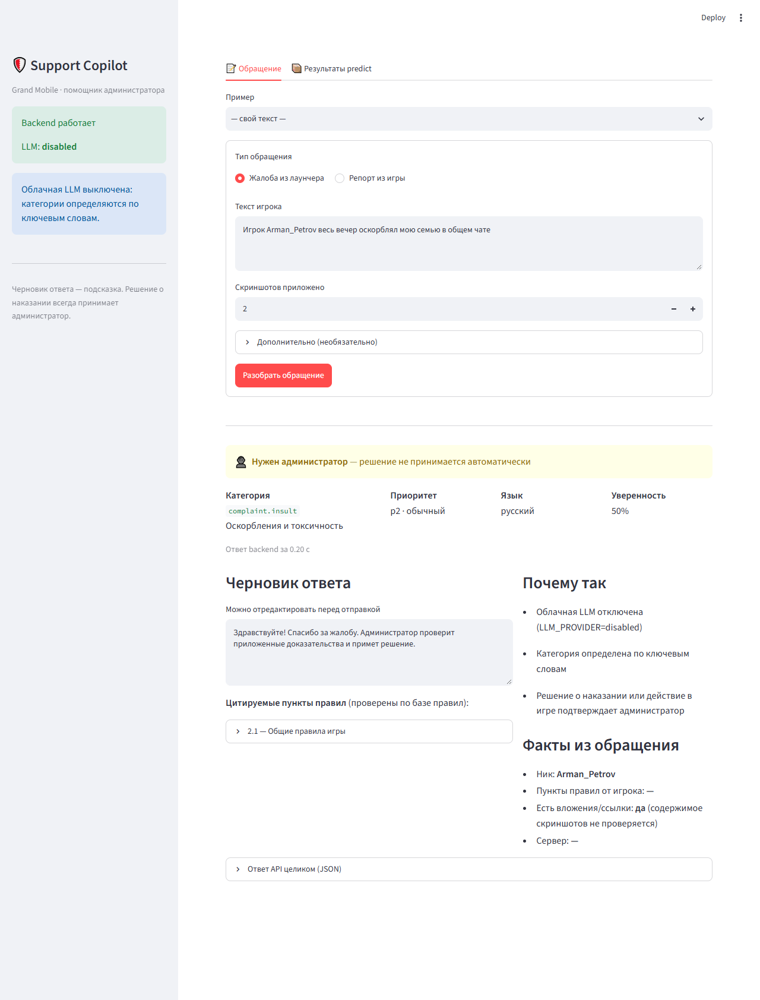
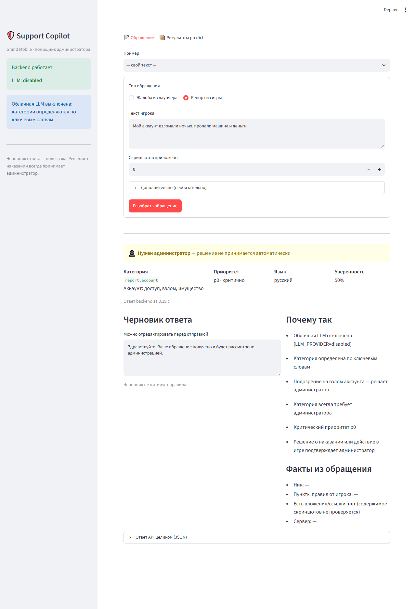
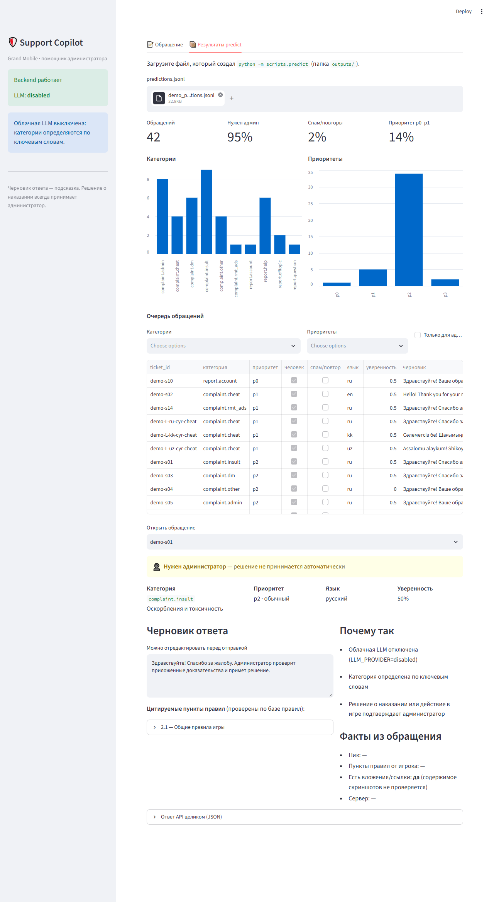
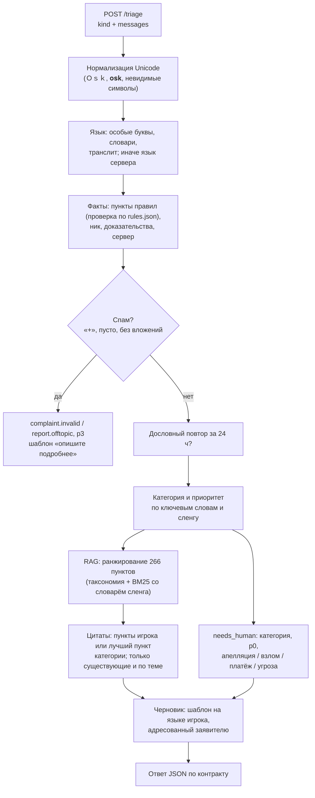
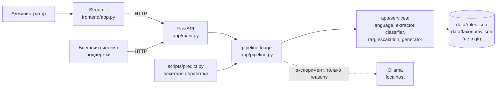

# Support Copilot by Grand Mobile

**AI-помощник администратора поддержки игры Grand Mobile** — решение кейса Decentrathon 6.0.

Администраторы получают тысячи жалоб и репортов в день: «оск родни», «дм у банка», «помогите», «+». Каждое обращение
нужно прочитать, понять, найти пункт правил, оценить срочность и написать ответ. Support Copilot делает эту рутину
за миллисекунды: по одному обращению возвращает язык, категорию, приоритет p0–p3, факты, признак спама или повтора,
**черновик ответа на языке игрока с проверенными цитатами правил** и решение, нужен ли администратор.

**Решения о наказании, разбане, деньгах и взломе система не принимает** — она готовит их администратору.



| Документ | Что внутри |
|---|---|
| [API.md](API.md) | Контракт `POST /triage`: поля, примеры, ошибки |
| [FINAL_AUDIT.md](FINAL_AUDIT.md) | Финальный аудит: все метрики с выборками, методика, ограничения |
| [PROJECT_CONTEXT.md](PROJECT_CONTEXT.md) | Устройство проекта по файлам и функциям |
| [MANUAL_TESTS.md](MANUAL_TESTS.md) | Чеклист ручной проверки с ожидаемыми ответами |

---

## Содержание

1. [Возможности](#возможности)
2. [Как это работает](#как-это-работает)
3. [Архитектура и технологии](#архитектура-и-технологии)
4. [Результаты: Disabled vs Ollama](#результаты-disabled-vs-ollama)
5. [Почему основной режим — Disabled](#почему-основной-режим--disabled)
6. [Privacy & Security](#privacy--security)
7. [Установка и запуск](#установка-и-запуск)
8. [API](#api)
9. [Пакетная обработка и метрики](#пакетная-обработка-и-метрики)
10. [Ограничения и известные проблемы](#ограничения-и-известные-проблемы)
11. [Команда](#команда)

---

## Возможности

- **Классификация** обращения по таксономии кейса (14 категорий жалоб и репортов) и **приоритет p0–p3**.
- **Языки:** русский, казахский (кириллица и латиница), узбекский (латиница и кириллица), английский, испанский,
  португальский. Ответ — на языке игрока.
- **Извлечение фактов:** пункты правил, названные игроком (проверяются по базе правил), ник, наличие доказательств
  (только по числу скриншотов и ссылкам — содержимое не анализируется), сервер.
- **Спам и дословные повторы** одного игрока за 24 часа.
- **RAG по правилам:** ранжирование всех 266 пунктов правил; в ответ попадают только существующие и относящиеся
  к обращению пункты.
- **Черновик ответа** из шаблонов на 6 языках, адресованный тому, кто написал: без обещаний разбана, возврата денег,
  наказания другого игрока и без утверждения, что нарушение доказано.
- **Эскалация `needs_human`:** апелляции, взлом, платежи, угрозы и любые решения о наказании всегда уходят человеку.
- **Интерфейс администратора** (Streamlit): разбор одного обращения и дашборд очереди по файлу пакетной обработки.
- **Пакетная обработка** JSONL и **оценка качества** (безопасность, вердикты админов, эталон, RAG Recall@k).

| Взлом аккаунта → p0, человеку | Дашборд очереди по результатам пакетной обработки |
|---|---|
|  |  |

Скриншоты сделаны на выдуманных обращениях из `scripts/synthetic_tickets.py`, не на данных кейса.

---

## Как это работает

Основной режим (`LLM_PROVIDER=disabled`) — детерминированный pipeline без языковой модели:



**RAG без векторной базы.** Правил 266, и они короткие, поэтому они ранжируются в памяти без внешних сервисов. Учитываются
связь категории с пунктами из `taxonomy.json`, подсказка классификатора и BM25 по тексту обращения со словарём сленга
(«оск» → «оскорбление», «софт» → «стороннее ПО»). У одних и тех же номеров в разных документах уникальные ID
(«2.1» — общие правила, «GZ 1.2» — зелёная зона, «ЖБ 1.1.2» — правила жалоб). Цитата попадает в ответ, только если пункт
существует и либо назван игроком, либо относится к итоговой категории. Пункты зелёной зоны — только если она упомянута.

**Принципы:**
- Правила не выдумываются: каждая цитата проверяется кодом по базе правил.
- Слова игрока — заявление, а не факт; скриншоты учитываются только по количеству.
- Чувствительное всегда уходит человеку.
- Текст игрока — недоверенные данные: «игнорируй инструкции…» не меняет решений кода.

**Опциональные режимы LLM (не основные):**

| Режим | Статус | Что делает |
|---|---|---|
| `disabled` | **Основной, по умолчанию** | Всё, что описано выше. Данные не покидают сервер |
| `ollama` | Эксперимент, только localhost | Ответ **такой же, как в `disabled`**; предложение локальной модели пишется только в `reasons` и не меняет категорию, приоритет, `needs_human` и черновик |
| `gemini` | **Заблокирован для реальных тикетов** | API, интерфейс и пакетная обработка с ним не запускаются. Код сохранён для экспериментов на выдуманных обращениях (`scripts.eval_drafts`) |

---

## Архитектура и технологии



| Слой | Технологии |
|---|---|
| API | Python 3.13, FastAPI, Pydantic v2, Uvicorn |
| Логика | Чистый Python: регулярные выражения, BM25, правила эскалации, шаблоны на 6 языках |
| Интерфейс | Streamlit, pandas (обращается к backend только по HTTP) |
| Опционально | Ollama HTTP API (`httpx`), Google GenAI SDK (`google-genai`) — только для экспериментов |
| Тесты | pytest — 235 тестов, без сети |

```
app/
  main.py               FastAPI: POST /triage, GET /rules, GET /health; проверка data/ и .env при старте
  schemas.py            контракт API (Pydantic)
  pipeline.py           обработка одного обращения
  services/
    normalize.py        нормализация Unicode
    language.py         определение языка
    extractor.py        пункты правил, ник, доказательства, сервер
    deduplication.py    спам и дословные повторы
    classifier.py       категория и приоритет по ключевым словам
    rules.py            реестр 266 пунктов правил с уникальными ID
    rag.py              ранжирование правил, релевантность цитат
    escalation.py       needs_human, запрещённые обещания, адресат черновика
    generator.py        шаблоны ответов на 6 языках
    llm.py, llm_config.py, llm_providers.py   опциональные LLM-провайдеры и защита ключа
frontend/app.py         интерфейс администратора
scripts/                predict, evaluate, eval_rag, eval_drafts, synthetic_tickets, measure_llm, dataset
tests/                  235 тестов
docs/images/            скриншоты интерфейса (выдуманные данные)
data/                   файлы кейса — НЕ в git
outputs/                результаты прогонов — НЕ в git
```

---

## Результаты: Disabled vs Ollama

Оба режима измерены 2026-10-31 **на одних и тех же данных**: эталон из 80 тикетов кейса и 25 выдуманных обращений
(5 ситуаций × ru, kk-кириллица, kk-латиница, uz-латиница, uz-кириллица). Всё считалось локально: Ollama `qwen2.5:3b`
на RTX 3050 Laptop 4 ГБ. Замер Ollama сделан, когда модель **сама решала** категорию и черновик, — именно по нему
принято решение оставить её экспериментом.

| Метрика | **Disabled** | Ollama `qwen2.5:3b` |
|---|---|---|
| Category accuracy (эталон 80) | **85.0%** | 67.5% |
| Priority macro-F1 (эталон 80) | **0.88** | 0.80 |
| needs_human recall (эталон 66 + языки 25) | **100%** | 100% |
| Черновики, слепая оценка 1–5 (105 обращений) | **3.72**, плохих 0 | собственные черновики модели 2.94, плохих 10 из 31 |
| Казахский: категория (10) | **9/10** | 6/10, черновики модели бессвязные |
| Узбекский: категория (10) | **9/10** | 5/10, черновики модели бессвязные |
| p50 / p95 задержки (эталон 80) | **< 0.01 / 0.01 с** | 2.65 / 5.26 с |

**Основной режим на полной выборке valid (1000 тикетов кейса):**

| Метрика | Значение |
|---|---|
| 6 инвариантов безопасности (цитаты существуют, нет запрещённых обещаний, адресат, язык, вид тикета, эскалация) | **100%** каждый |
| Категория совпала с пунктом наказания админа | 87.1% (128/147) |
| Апелляции распознаны | 53.9% (48/89) |
| RAG Recall@8 пункта наказания админа | 0.934 (без ссылки игрока — 0.912) |
| Цитаты в ответе | 503 из 1000 тикетов; все существуют; совпадение с пунктом из вердикта админа 79/92 |
| Обязательные правила needs_human | 0 нарушений |
| p50 / p95 полного `POST /triage` по HTTP | **1.7 / 3.5 мс** |
| Стоимость | $0 на тикет |

**Как читать эти цифры:** эталон мал и размечен AI-ассистентом, правила ключевых слов подбирались с оглядкой на него —
оценка на эталоне завышена; независимая проверка — вердикты админов в valid (87.1%). Языковой набор написан командой
и использовался для поиска ошибок. Черновики оценивал AI-ассистент вслепую, не человек. Подробности — в
[FINAL_AUDIT.md](FINAL_AUDIT.md).

---

## Почему основной режим — Disabled

1. **Качество.** На одних и тех же данных Disabled точнее Ollama по категории (+17.5 п.п.) и по приоритету.
2. **Безопасность ответа.** Собственные черновики локальной модели в трети случаев выдумывали факты, обвиняли заявителя
   или решали за администратора; казахский и узбекский — бессвязные. Шаблоны Disabled таких ошибок не дают.
3. **Скорость и стоимость.** p95 API — 3.5 мс против ~5 с у Ollama на ноутбуке; $0 без GPU.
4. **Приватность.** Данные игроков не покидают сервер.
5. **Предсказуемость.** Детерминированный результат, который можно проверить тестами.

Ollama оставлена как эксперимент: интеграция работает и пишет свою версию в `reasons`, но не меняет ответ.
Gemini не используется для реальных тикетов, пока не подтверждена допустимость такой обработки данных.

---

## Privacy & Security

- **Реальные тикеты не уходят во внешние сервисы.** В основном режиме сетевых вызовов нет. Ollama разрешена только
  по адресу `localhost`, `127.0.0.1` или `::1`. Gemini (бесплатный тариф Google использует присланные данные)
  **заблокирован для реальных тикетов**: API и пакетная обработка с `LLM_PROVIDER=gemini` не запускаются.
- **Секреты.** Ключ Gemini хранится только в локальном `.env`; `.env` и `.env.*` в `.gitignore`. В логах, ответах API и
  интерфейсе ключа нет: настройки печатаются как `api_key=***`, ошибки SDK очищаются от ключа. Если ключ по ошибке
  вставлен не в ту строку `.env`, он не выводится в сообщении об ошибке.
- **Данные кейса не публикуются.** `data/` и `outputs/` не попадают в git; в README и на скриншотах — только выдуманные
  обращения; тексты правил не публикуются (только их ID).
- **Недоверенный ввод.** Длина текстов и число сообщений ограничены схемой; prompt injection в тексте игрока не меняет
  решений кода; черновик проверяется на запрещённые обещания и адресата.
- **Решения о наказании принимает человек:** `needs_human` нельзя снять кодом LLM; апелляции, взлом, платежи и угрозы
  эскалируются всегда.

---

## Установка и запуск

### Требования

- Python 3.11+ (проверено на 3.13.5), Windows 10/11. На Linux/macOS команды через `make` не проверялись.
- Файлы кейса Decentrathon (не входят в репозиторий): `rules.json`, `taxonomy.json`, для пакетной обработки и метрик —
  `tickets_valid.jsonl`, `tickets_train.jsonl.gz`, для эталона — `eval_gold.jsonl`, `eval_gold_tickets.jsonl`.

### Установка (Windows, PowerShell, из папки проекта)

```powershell
py -3 -m venv .venv
.\.venv\Scripts\python.exe -m pip install -r requirements.txt
copy .env.example .env
```

Положите файлы кейса в папку `data\`. Без `data\rules.json` и `data\taxonomy.json` сервис и тесты сразу остановятся
с сообщением «Нет файлов кейса…».

`.env` из шаблона уже настроен на основной режим (`LLM_PROVIDER=disabled`), ключи не нужны.

### Запуск — два окна PowerShell

```powershell
.\.venv\Scripts\python.exe -m uvicorn app.main:app            # backend: http://127.0.0.1:8000/docs
```

```powershell
.\.venv\Scripts\python.exe -m streamlit run frontend/app.py   # интерфейс: http://localhost:8501
```

Проверка: http://127.0.0.1:8000/health → `{"status":"ok","llm_provider":"disabled"}`.

### Тесты

```powershell
.\.venv\Scripts\python.exe -m pytest -q                       # 235 тестов, без сети
```

Linux/macOS (не проверялось): `make install`, `make run`, `make frontend`, `make test`.

<details>
<summary>Частые проблемы</summary>

| Симптом | Решение |
|---|---|
| «Нет файлов кейса: data/rules.json…» | Положите файлы кейса в папку `data/` |
| «выполнение сценариев отключено» при `Activate.ps1` | Не меняйте политику — запускайте через `.\.venv\Scripts\python.exe -m …` |
| «Gemini Free Tier запрещён для реальных тикетов» | Так и задумано: в `.env` поставьте `LLM_PROVIDER=disabled` |
| Ошибка кодировки в консоли у скриптов | Запускайте с `-X utf8`, как в примерах ниже |
| «address already in use» | Сервер уже запущен в другом окне — используйте его или закройте окно |
| Интерфейс: «Backend недоступен» | Запустите backend; если он на другом адресе — задайте `BACKEND_URL` |
| Метрики не изменились после правок | `predict` продолжил старый файл — запустите с `--fresh` |

</details>

<details>
<summary>Ключ Google Gemini API (только для экспериментов на выдуманных обращениях)</summary>

Для основного режима ключ **не нужен**. Он нужен только для эксперимента `scripts.eval_drafts --provider gemini`:
скрипт прогоняет через Gemini 16 выдуманных обращений из `scripts/synthetic_tickets.py`.

1. Получите ключ **Google Gemini API** самостоятельно в [Google AI Studio](https://aistudio.google.com/apikey).
   Желательно в проекте Google **без** подключённого Billing, чтобы исключить случайные расходы. Это нужно проверить
   вручную: код этого не гарантирует.
2. Укажите ключ в **локальном** файле `.env` в переменной `GEMINI_API_KEY`:

   ```
   LLM_PROVIDER=gemini
   GEMINI_API_KEY=your_gemini_api_key
   ```

   `GEMINI_API_KEY` — ключ **только для Google Gemini API**. Это не универсальный ключ: он не подходит для других
   провайдеров (OpenAI, Anthropic и др.), а Ollama ключ не нужен. Модель задаёт `GEMINI_MODEL`, только из списка
   разрешённых в `app/services/llm_config.py` (по умолчанию `gemini-3.1-flash-lite`).
3. **Важно:** с `LLM_PROVIDER=gemini` backend, интерфейс и `scripts.predict` **не запустятся** — это защита от
   отправки реальных тикетов в Google. Поэтому для обычной работы оставьте `LLM_PROVIDER=disabled`, а ключ просто
   держите в `.env`. `eval_drafts` выбирает Gemini сам через параметр `--provider` и берёт ключ и модель из `.env`:

   ```powershell
   .\.venv\Scripts\python.exe -X utf8 -m scripts.eval_drafts --provider gemini
   ```

**Хранение ключа:**
- `.env` — только на вашем компьютере. Он (и `.env.*`) указан в `.gitignore` и **не должен попадать в GitHub**.
- `.env.example` публикуется и должен содержать только пустое значение: `GEMINI_API_KEY=`.
- Перед коммитом проверьте: `git status` не показывает `.env`, а `git grep -n "GEMINI_API_KEY"` находит только пустую
  строку в `.env.example` и упоминания в коде и документации.
- Если ключ всё-таки попал в git или к посторонним, перевыпустите его в Google AI Studio.

</details>

<details>
<summary>Экспериментальный режим Ollama</summary>

Нужна локально запущенная Ollama с заранее скачанной моделью (приложение ничего не скачивает само). В `.env`:

```
LLM_PROVIDER=ollama
OLLAMA_MODEL=qwen2.5:3b
OLLAMA_BASE_URL=http://localhost:11434
```

Ответ остаётся как в основном режиме; предложение модели — в `reasons` («Ollama (эксперимент, на ответ не влияет)…»).
Если Ollama не запущена, сервис стартует, а в `/health` будет `llm_warning`.

</details>

---

## API

Полный контракт — [API.md](API.md), интерактивная документация — http://127.0.0.1:8000/docs.

| Метод | Путь | Назначение |
|---|---|---|
| `POST` | `/triage` | Разбор одного обращения |
| `GET` | `/rules?ids=2.1&ids=GZ%201.2` | Тексты пунктов правил по ID (параметр повторяется) |
| `GET` | `/health` | Статус и активный режим LLM |

**Запрос** (`attachments` — число скриншотов; `kind` — `complaint` или `report`):

```json
{
  "kind": "complaint",
  "messages": [
    {"role": "player", "text": "Игрок Arman_Petrov весь вечер оскорблял мою семью в общем чате", "attachments": 2}
  ]
}
```

**Ответ** (фактический ответ сервиса на этот запрос):

```json
{
  "lang": "ru",
  "category": "complaint.insult",
  "priority": "p2",
  "is_spam_or_duplicate": false,
  "extracted": {"nickname": "Arman_Petrov", "rule_refs": [], "has_evidence": true, "server": null},
  "draft_reply": {
    "lang": "ru",
    "text": "Здравствуйте! Спасибо за жалобу. Администратор проверит приложенные доказательства и примет решение.",
    "cited": ["2.1"]
  },
  "needs_human": true,
  "confidence": 0.5,
  "reasons": [
    "Облачная LLM отключена (LLM_PROVIDER=disabled)",
    "Категория определена по ключевым словам",
    "Решение о наказании или действие в игре подтверждает администратор"
  ]
}
```

Вызов из PowerShell:

```powershell
$body = @{ kind = "complaint"; messages = @(@{ role = "player"; text = "оск родни 2.1 оп"; attachments = 2 }) } | ConvertTo-Json -Depth 5
Invoke-RestMethod -Uri http://127.0.0.1:8000/triage -Method Post -ContentType "application/json; charset=utf-8" -Body ([System.Text.Encoding]::UTF8.GetBytes($body))
```

Вызов из Python:

```python
import httpx

body = {"kind": "report", "messages": [{"role": "player", "text": "Мой аккаунт взломали ночью", "attachments": 0}]}
print(httpx.post("http://127.0.0.1:8000/triage", json=body).json())
```

Необязательные поля запроса: `reporter_id` и `reported_nick` (для поиска повторов), `created_at`, `server_lang`
(язык сервера, если по тексту язык не определить). Неверный запрос → HTTP 422.

---

## Пакетная обработка и метрики

`scripts.predict` обрабатывает JSONL в формате тикетов кейса (`ticket_id`, `kind`, `messages`, `images_count`, …) и пишет
одну строку ответа `/triage` на тикет. Результат можно открыть во вкладке «Результаты predict» интерфейса.

```powershell
.\.venv\Scripts\python.exe -X utf8 -m scripts.predict --provider disabled --fresh --output outputs/valid.jsonl
.\.venv\Scripts\python.exe -X utf8 -m scripts.evaluate --pred outputs/valid.jsonl
.\.venv\Scripts\python.exe -X utf8 -m scripts.eval_rag --file data/tickets_valid.jsonl
```

| Команда | Что делает |
|---|---|
| `predict` | По умолчанию `data/tickets_valid.jsonl` → `outputs/predictions_valid.jsonl`; `--input`, `--output`, `--limit N`, `--provider disabled\|ollama`. **Без `--fresh` продолжает файл с места остановки и не пересчитывает готовые тикеты** |
| `evaluate` | 6 инвариантов безопасности, совпадение с вердиктами админов (всего и по языкам), эталон `data/eval_gold.jsonl` (категория, macro-F1 приоритетов, recall needs_human) |
| `eval_rag` | Recall@k / Precision@k / MRR пункта наказания админа среди кандидатов RAG |

Весь valid (1000 тикетов) обрабатывается примерно за секунду.

---

## Ограничения и известные проблемы

- **Эталон мал (80) и размечен AI-ассистентом**; оценка на нём завышена. Независимая метрика — вердикты админов в valid.
- **Классификация:** апелляции без явных слов часто уходят в `complaint.other` (распознаётся 53.9% апелляций в valid);
  короткие жалобы без смысловых слов получают p2 вместо p3 — сознательно: такие жалобы админы нередко одобряют.
- **Повторы:** отмечаются только дословные повторы одного игрока (0 из 18 тикетов с вердиктом `duplicate` в valid).
- **Эскалация широкая:** человеку уходит 938 из 1000 тикетов valid — решение о наказании по замыслу принимает админ;
  выигрыш — в сортировке, приоритете, фактах, цитатах и готовом черновике.
- **Цитаты** зависят от категории: при неверной категории цитата тоже неверна. Для `report.*` и `complaint.other`
  автоматической цитаты нет.
- **Черновики** — безопасные, но общие шаблоны.
- **Языки:** казахских обращений в данных мало (10 в valid) — казахские правила почти не проверены на реальных данных;
  испанский и португальский не измерены.
- **Содержимое скриншотов не анализируется** — учитывается только их количество.
- **Ollama** на ноутбуке медленнее и хуже основного режима; **Gemini** не используется для реальных тикетов до
  подтверждения допустимости обработки данных.
- Установка в новое чистое окружение и запуск на Linux/macOS не проверялись.

---

## Команда

| Участник | Роль |
|---|---|
| Adil | Backend, pipeline классификации, RAG, правила эскалации, интерфейс Streamlit, оценка качества, документация |

Разработка велась с помощью AI-ассистента Claude Code. Решения по архитектуре, данным и безопасности принимал участник
команды.
